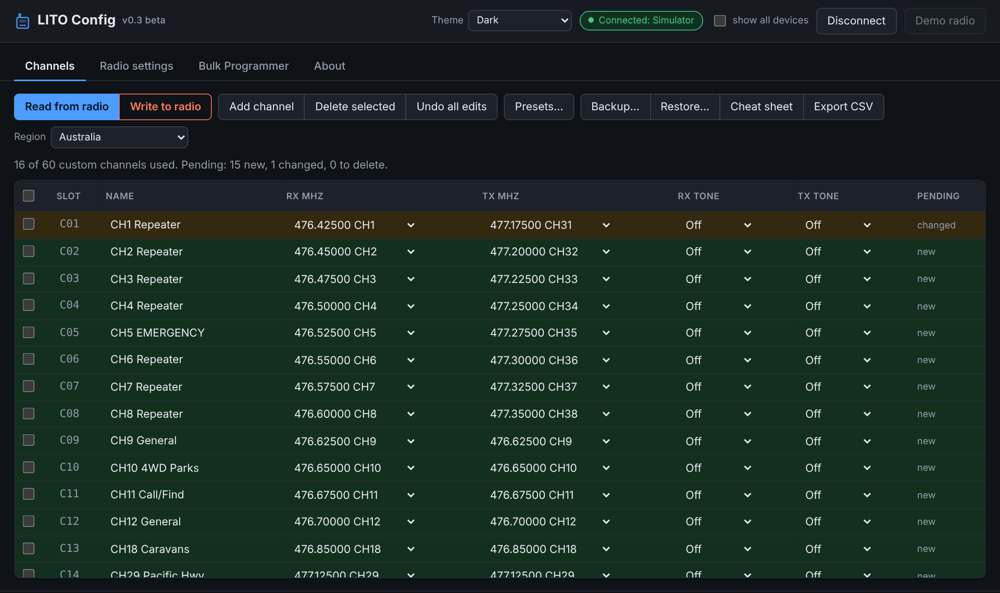
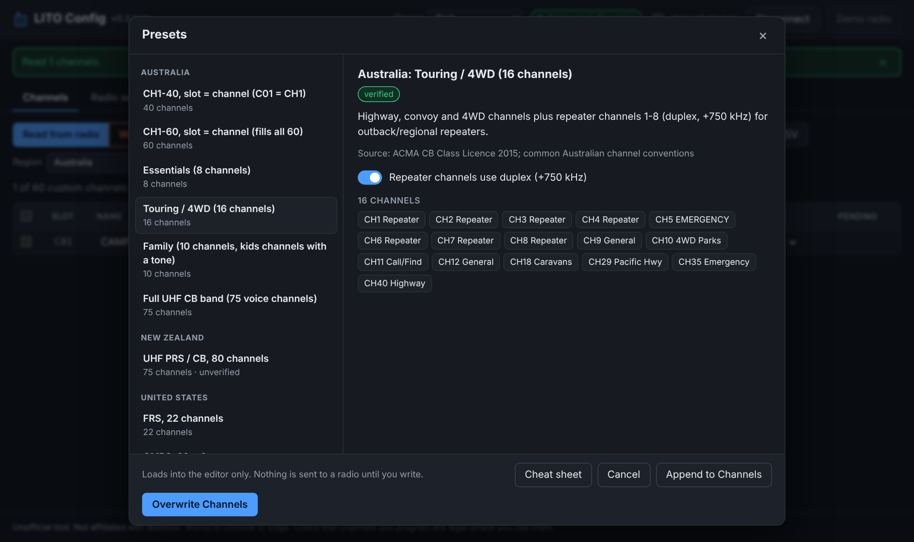
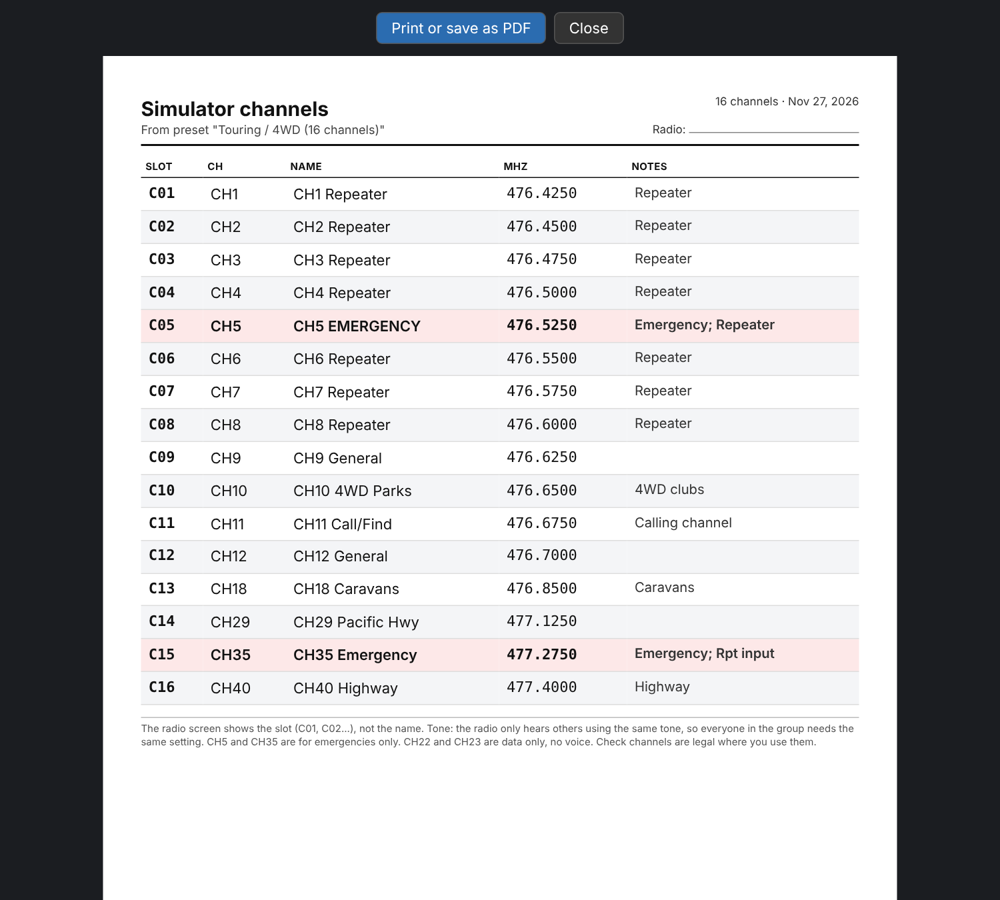
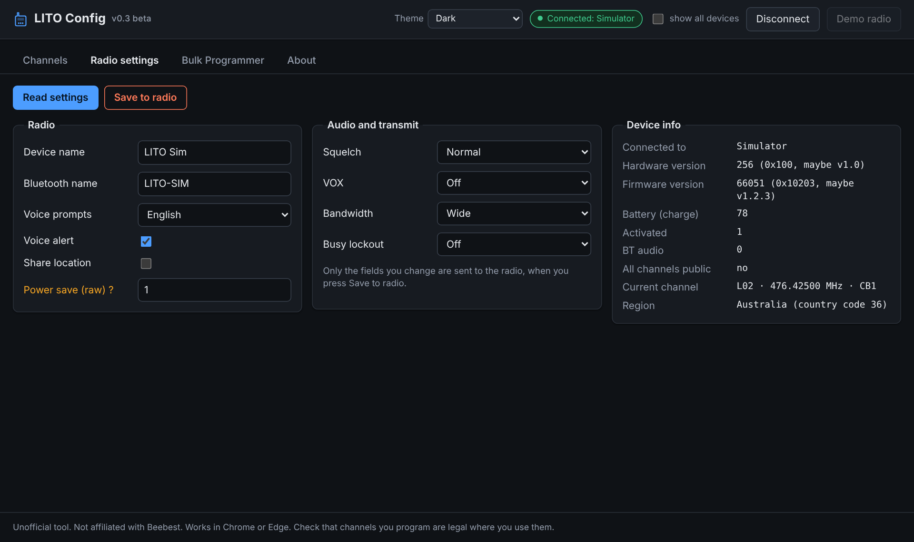
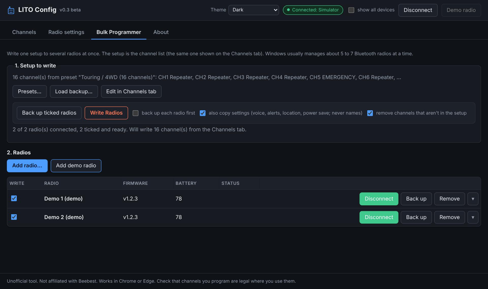
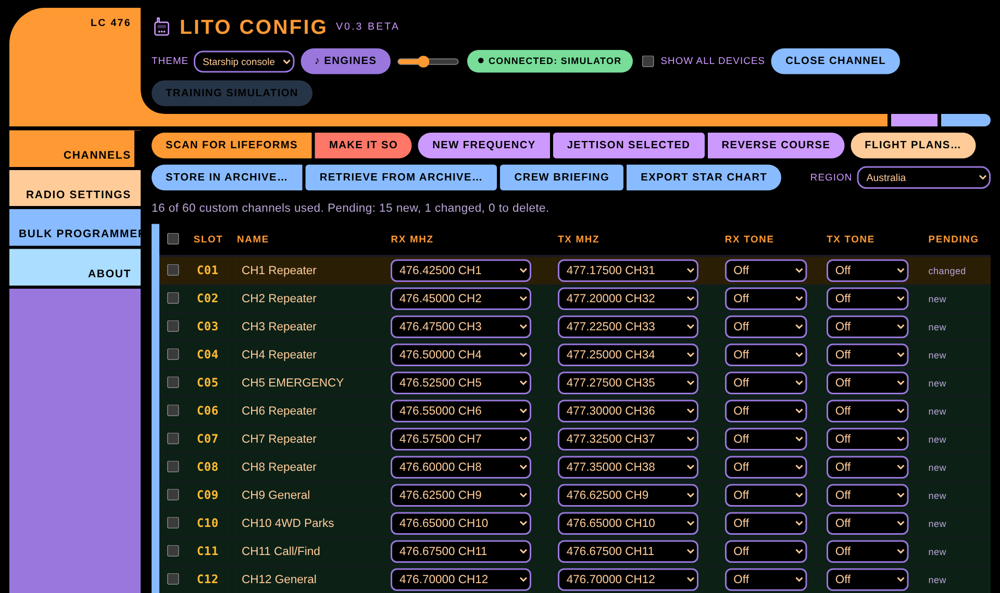

# LITO Config

An unofficial browser app for backing up and programming **Beebest LITO** UHF CB radios over Bluetooth.

**Try it:** https://felixrising.github.io/lito-config/ (Chrome or Edge on Windows, macOS, ChromeOS or Android). Press **Demo radio** to try it without a radio.

> Not affiliated with or endorsed by Beebest. Use at your own risk. Save a backup before writing, and only program channels that are legal where you use them (in Australia: no voice on CH22/23)

## What it does

- **Channels:** read, edit, add and delete the radio's custom channels, then write only the differences back.
- **Radio settings:** names, voice prompts and alerts, plus the radio-wide squelch, VOX, bandwidth and busy lockout.
- **Presets:** Australian UHF CB layouts, plus New Zealand, US FRS/GMRS and EU/UK PMR446.
- **Cheat sheets:** a printable one-page list of what each slot (C01, C02...) is.
- **Backup and restore:** full backups (`.lito.json`) and CSV export.
- **Bulk Programmer:** write one setup to several radios at once.
- **Developer tools** (turn on under About): a decoded Bluetooth log, a custom-frame sender and protocol status.

The radio holds 60 custom channels. Asking it for a 61st makes it reboot, so the app never writes more than 60.

## A quick tour

All screenshots use the built-in demo radio, so you can follow along without a radio: press **Demo radio**.

### Channels



- **Read from radio** loads the radio's channels into the table. **Write to radio** sends only what changed; the **Pending** column shows what will be added, changed or deleted, and rows are coloured to match.
- **Slot** is what the radio's screen shows (C01, C02...). The radio doesn't display channel names, which is why the cheat sheet exists.
- **RX MHz** and **TX MHz** are fixed lists of the frequencies the radio accepts in your **Region** (picked automatically from the radio). Each entry shows its channel number, for example `476.42500 CH1`. TX also offers *No transmit (listen only)*.
- **RX tone** and **TX tone** list the CTCSS tones and DCS codes. A radio only hears others using the same tone, so give everyone in a group the same setting.
- **Undo all edits** puts the table back to what was last read. **Backup…** saves everything to a file, and **Restore…** loads it back into the editor. Nothing is sent to the radio until you press Write.

### Presets



Pick a ready-made channel list on the left. The right side explains it and previews each channel (hover a chip for its frequency and tone).

- **Overwrite Channels** replaces your custom channels. **Append to Channels** adds the preset after them.
- The *slot = channel* presets keep C01 = CH1, C02 = CH2 and so on. For those you can choose what the repeater slots (CH1-8 and CH41-48) do: talk through the repeater (+750 kHz), become a spare copy of a simplex channel (handy on kids' radios), or listen only.
- **Cheat sheet** prints the preset as it would be written.

### Cheat sheet



One A4 page listing slot, CB channel, name, frequency, tone and notes (Emergency, Repeater, Data only, Listen only). Press **Print or save as PDF**. It's available from the Presets dialog and from the Channels tab (your current list).

### Radio settings



- **Radio:** device name, Bluetooth name, voice prompts, voice alert and location sharing.
- **Audio and transmit:** squelch, VOX, bandwidth and busy lockout. These apply to the whole radio, not to one channel.
- **Device info:** firmware, battery, region and the channel the radio is on right now.

Only the fields you change are sent when you press **Save to radio**.

### Bulk Programmer



Turn it on under **About**. It writes one setup to several radios.

1. **Setup to write:** the channel list from the Channels tab. Load it from **Presets…** or **Load backup…**, or edit it on the Channels tab.
2. **Radios:** press **Add radio…** for each radio. The button colour shows the connection: green is connected, amber is busy. Each row has **Back up** and an expand arrow to read and view that radio's channels.

Then tick the radios and press **Write Radios**. Tick *back up each radio first* to save a backup of each radio before writing. The app refuses to write an empty setup.

### Kobayashi console theme



Choose **Theme → Kobayashi console** in the header for a retro sci-fi control panel, with playful button names (hover any button for its plain name). It also plays an engine-room hum made live in your browser (no recordings). The hum is on by default at 25% and starts on your first click, because browsers don't allow sound before that. Press **♪ Engines online** to mute it; the app remembers. The theme is the default every 8 September unless you've picked one.

## Using it

1. Open the link above in Chrome or Edge. Firefox and Safari don't support Web Bluetooth.
2. Close the official app on your phone first: the radio accepts one Bluetooth connection at a time.
3. Press **Connect radio**, pick your LITO, and accept on the radio the first time.
4. Press **Read from radio**, then **Backup…** to save a backup before you change anything.

To run it locally, serve the folder over `http://localhost` (for example `npx serve` or `python -m http.server`). On Windows, `start.cmd` does this with PowerShell only. Opening `index.html` straight from disk won't work, because Web Bluetooth needs https or localhost.

## Privacy

The app runs entirely in your browser. Radio settings, backups and presets never leave your computer, apart from files you choose to save.

The published site at felixrising.github.io counts page visits with [Cloudflare Web Analytics](https://www.cloudflare.com/web-analytics/). It sets no cookies, doesn't fingerprint your browser and collects no personal data, only anonymous page views, referrers, country and browser type. It doesn't run on a local copy (localhost), and content blockers that block it don't affect the app.

## Help finish the decoding

A few values are still raw numbers: TX power, power level, power save and the "all public" flag. The **Protocol status** tab (developer tools) lists what's confirmed and what isn't. If you work one out, for example by changing it in the official app and reading it back here, open an issue or pull request with what you changed and the downloaded log.

## Code

```
lito/            protocol layer, no dependencies, runs in browsers and Node
  frame.js       framing and CRC-16/MCRF4XX
  protobuf.js    small schema-driven proto2 codec
  schema.js      SEAL_* messages, enums and command IDs
  values.js      frequency and tone encodings
  client.js      LitoClient: handshake, settings, channel read/write (any transport)
  ble.js         Web Bluetooth transport
  simulator.js   simulated radio for the demo and tests
  configfile.js  editor model, diffing, .lito.json and CSV
  sync.js        apply a setup to a radio (used by the Bulk Programmer)
  presets.js     channel presets
  bands.js       allowed frequencies per region
app/             the UI (vanilla JS, no build step): app.js, cheatsheet.js, ambience.js, themes
tests/           node --test (npm test, Node 20+)
docs/            protocol notes, the reconstructed seal.proto and screenshots
```

`docs/LITO-BLE-protocol.md` describes the Bluetooth protocol for interoperability. It was worked out from the official app's behaviour and confirmed on real radios. No code from the official app is included.

## Licence

MIT. See [LICENSE](LICENSE).
